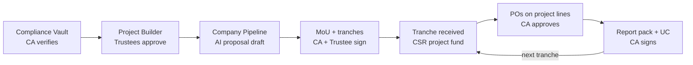

# OMG Platform — CSR Module: Research + Build Plan (for Claude Code)

> Put this file in the repo at `docs/csr/PLAN.md`.
> It reuses the shared tables from the Event plan (`approvals`, `funds`, purchase orders). Build Events first, or at least Phase 1 of it.
> Research checked in October 2026. Law changes often — the CA team must verify Part A before go-live. This is not legal advice.

---

# PART A — Research: what the law needs

## A1. The basics in plain words

- A company must spend on CSR if, in the previous financial year, it had **net worth ≥ ₹500 crore, OR turnover ≥ ₹1,000 crore, OR net profit ≥ ₹5 crore**. It must spend **2% of its average net profit of the last 3 years**.
- The money can only go to activities listed in **Schedule VII** of the Companies Act (education, health, hunger, heritage, environment, etc.).
- Companies can give the money to an outside **implementing agency** (a trust, society or Section 8 company). Our customers (Sevalaya, Tamil Sangam, a temple's charitable trust) would be that implementing agency.
- The company's CFO must certify that CSR money was used as approved. So the company will ask us for proof: a **Utilisation Certificate (UC)**, bills, photos, progress — that is the "CA signs certificate" box in the sheet.

## A2. Recent and pending changes (important for design)

| Change | Status (Oct 2026) | What it means for the app |
|---|---|---|
| **Income-tax Act, 2025** replaced the 1961 Act from 1 April 2026 | In force | "12A" is now **RNPO registration under Section 332**; "80G" approval is now **Section 354**. Valid old registrations carry over automatically until their original expiry. Companies' forms still say "12A / 80G". Store both old and new references. |
| **CSR Amendment Rules, 2026** (notified May 2026) | In force | New channel: companies can fund NPOs listed on the **Social Stock Exchange** through Zero Coupon Zero Principal (ZCZP) instruments. Thresholds not changed. **Out of scope for v1**, note for later. |
| **Corporate Laws (Amendment) Bill, 2026** | Pending — Joint Parliamentary Committee reported on 3 Aug 2026 | Proposes raising the profit threshold from ₹5 crore to ₹10 crore and giving 90 days (instead of 30) to move unspent money of ongoing projects. **Keep thresholds and day-counts in config, never hard-code.** |

## A3. Who can receive CSR money (the onboarding checklist)

An implementing agency needs **all** of these:

| # | Requirement | Where it is done | Expires? |
|---|---|---|---|
| 1 | Legal entity: registered public trust, society, or Section 8 company | Sub-registrar / Registrar of Societies / MCA | No |
| 2 | Tax-exempt registration (old 12A/12AB → new **RNPO, Sec 332**) | Income-tax portal | **Yes** — regular registration is time-bound (typically 5 years; provisional is shorter). Track expiry. |
| 3 | Donor deduction approval (old 80G → new **Sec 354**) | Income-tax portal | **Yes** — track expiry |
| 4 | **3-year track record** of similar work | Proof: activity reports, audited accounts | — (exception: an entity set up by the company itself) |
| 5 | **Form CSR-1** on the MCA portal → CSR Registration Number | MCA portal, signed with the authorised signatory's **DSC**, certified by a practising CA / CS / CMA | Stays active only while #2 and #3 are valid |
| 6 | Audited accounts + ITRs for last 3 years, PAN, governing body list, board resolution | — | Yearly |
| 7 | NGO Darpan ID (NITI Aayog) | ngodarpan.gov.in | Not legally required for CSR, but many companies and PSUs ask for it |
| 8 | Separate bank account for CSR money | Bank | Not strictly required by law, but most MoUs demand it |

**The app's job:** keep these documents, their expiry dates, and block CSR pitching if anything is missing or expired.

## A4. What each of our sectors can do

| Sector | CSR status | Reason / action |
|---|---|---|
| **Sevalaya** | Can take CSR now | Matches the sheet. Verify CSR-1 number and 80G/RNPO expiry dates are loaded. |
| **Tamil Sangam** | **After registration — but check the 3-year rule** | If it is newly registered, it may need 3 years of track record before CSR-1. Ask: when was it registered, and does it have audited accounts for 3 years? |
| **Temple** | **Not directly** | A trust whose purpose is wholly or substantially religious generally cannot get 80G approval, so it cannot get CSR-1. Routes (same as the sheet): (a) a **separate charitable trust** for schools/annadhanam/health — still needs its own 3-year record; (b) a **partner NGO** that already has CSR-1 runs the project; (c) **heritage restoration** under Schedule VII item (v) — only for buildings of genuine historical importance, usually needing archaeology / endowment department permission (HR&CE for Tamil Nadu temples — CA/legal to confirm). |

## A5. What CSR money can and cannot be spent on

**Allowed** (examples for our sectors): annadhanam / hunger (item i), school, scholarships, skill training (ii), health camps (i), elderly and orphan care (iii), heritage restoration, traditional arts, public library (v), environment, trees, water (iv).

**Not allowed — the platform must block these on CSR funds:**
- Poojas, religious rituals, festival celebrations (already in the sheet).
- One-off events, marketing sponsorship, advertising for the company. **Note for Events module:** a company sponsoring Navaratri is **sponsorship, not CSR**. Keep them in different funds.
- Activities that benefit only the funding company's employees.
- Contributions to political parties.
- Activities outside India.
- Anything the company is anyway legally required to do.

## A6. Other rules the app must support

| Rule | What the app does |
|---|---|
| **Admin overheads ≤ 5%** of the company's CSR spend (company-side rule; MoUs often pass a cap to the NGO) | Each project has an admin-overhead line with a cap % from the MoU; POs above the cap are blocked. |
| **Capital assets** made with CSR money (building, equipment) cannot be owned by the company — the implementing agency holds them | Asset register: item, cost, location, project, photo. Needed in UC. |
| **Ongoing projects** can run up to 3 years after the starting year; unspent amounts go to an "Unspent CSR Account" on the **company** side | Tranche schedule aligned to the company's financial year; alert when March 31 is near and money is unspent. |
| **Impact assessment** by an independent agency — required when the company's average CSR obligation is ≥ ₹10 crore and the project is ≥ ₹1 crore, at least 1 year after completion | Flag on the deal; app produces a data pack (beneficiaries, spend, photos, outcomes). |
| **CSR-2 annual filing** is done by the company | App exports what they need: project name, Schedule VII item, location, amount spent, our CSR Registration Number. |
| **Children's data** (school projects) | Personal data of children needs parental consent under the DPDP Act. Store consent; never put children's faces in public reports without consent. |

## A7. Open questions for the CA team (answer before Phase 2)

1. Do we issue an 80G / Sec 354 receipt for CSR money, or only a plain acknowledgement? (Companies usually do not claim a deduction for mandatory CSR — CA to decide.)
2. One bank account per project, or one CSR account with project-wise ledgers?
3. Who certifies the UC — our statutory auditor, or any practising CA?
4. Tamil Sangam: registration date and audited-accounts history (3-year rule).
5. Temple: which route — new charitable trust, partner NGO, or heritage? Any HR&CE approval needed?
6. GST: any GST impact on CSR grants received? (Usually no supply, but confirm.)

---

# PART B — Application design

## B1. The 6 steps from the sheet, mapped to screens

| Step | Sheet says | App screen | Gate |
|---|---|---|---|
| 1 Get ready | Check eligibility; keep CSR-1, tax registration, audited accounts current | **Compliance Vault** — documents, expiry dates, readiness score | ◆ CA verifies each document |
| 2 Plan project | Pick eligible work; pooja costs blocked | **Project Builder** — Schedule VII item, budget lines, beneficiaries, location, timeline | ◆ Trustees approve |
| 3 Find company | Shortlist companies; pitch Oct–Feb | **Company Pipeline** (simple CRM) + AI proposal draft | — (CSR desk) |
| 4 Sign agreement | Proposal + documents; MoU with instalments | **Deal & MoU** — tranche schedule, conditions, signed MoU upload | ◆ CA + Trustee sign |
| 5 Receive & spend | Money by bank into separate CSR fund; spent only on approved orders | **Tranche receipt** → CSR fund → POs on project lines only | ◆ CA approves each order |
| 6 Report back | Photos, progress, CA certificate; then next instalment | **Report Pack** — progress, photos, UC, fund statement, next tranche request | ◆ CA signs UC |

## B2. Status flows

**Entity readiness** (per customer entity):
```
NOT_READY → DOCS_UPLOADED → CA_VERIFIED → CSR_READY
CSR_READY → EXPIRING_SOON (60 days before any expiry) → NOT_READY (on expiry)
```
Pitching, new MoUs and receipts are **blocked unless `CSR_READY`**.

**Project:**
```
DRAFT → SUBMITTED → TRUSTEE_APPROVED → OPEN_FOR_FUNDING → FUNDED (fully/partly) → IN_PROGRESS → COMPLETED → CLOSED
```

**Deal (one company funding one project):**
```
LEAD → SHORTLISTED → PITCHED → PROPOSAL_SENT → DUE_DILIGENCE → MOU_DRAFT
→ MOU_APPROVED (CA + Trustee) → MOU_SIGNED → ACTIVE → COMPLETED
   (LOST / ON_HOLD possible from any stage before MOU_SIGNED)
```

**Tranche (instalment):**
```
SCHEDULED → CONDITIONS_MET (previous UC signed, milestone done) → REQUESTED → RECEIVED → UTILISED → UC_SIGNED
```
Rule: tranche N+1 can be `REQUESTED` only after tranche N is `UC_SIGNED` (unless the MoU says otherwise).



## B3. Hard rules the server must enforce

1. CSR fund money can be spent **only** through POs linked to a budget line of the **same** project.
2. Budget line categories marked `blocked_for_csr` (pooja, ritual, festival, marketing, event) cannot be added to a CSR project at all.
3. Admin-overhead line spend ≤ MoU cap %.
4. Approver ≠ preparer at every gate (shared approvals table).
5. No receipt, pitch or MoU when entity is not `CSR_READY`.
6. Capital-asset POs must create an asset-register entry before payment is released.
7. Schedule VII item and thresholds come from config tables, editable by Super Admin only.
8. Every document, approval and money movement is in the audit trail.

## B4. Where AI helps (and where it must not)

| Use AI for | Do NOT use AI for |
|---|---|
| Drafting the proposal from project data (Claude) | Deciding eligibility — that is a checklist + CA sign-off |
| Suggesting a Schedule VII item from the project description (admin confirms) | Choosing the final Schedule VII item without human confirmation |
| Summarising company CSR focus areas from text the CSR desk pastes in (annual report / CSR policy) | Scraping websites automatically in v1 |
| Writing the progress narrative from photos + numbers | Any number in the UC or fund statement — those come from the ledger only |
| Ranking shortlisted companies by match (sector, state, budget size) | Sending anything to a company without CSR desk review |

Company research source for the CSR desk: the **National CSR Portal (csr.gov.in)** shows company-wise CSR spending by sector and state, plus companies' annual reports. v1 = manual entry/import, no scraping.

## B5. Tables (PostgreSQL — adapt to existing backend)

```sql
-- 1. Compliance vault
create table csr_entities (
  id                 uuid primary key default gen_random_uuid(),
  customer_id        uuid not null references customers(id),
  sector             text not null,           -- SEVALAYA, TAMIL_SANGAM, TEMPLE_CHARITABLE_TRUST, PARTNER_NGO
  legal_name         text not null,
  entity_type        text not null check (entity_type in ('TRUST','SOCIETY','SECTION8')),
  pan                text not null,
  registration_date  date not null,           -- for 3-year track record check
  csr1_reg_no        text,                    -- e.g. CSR00012345
  darpan_id          text,
  is_partner_ngo     boolean not null default false,
  readiness_status   text not null default 'NOT_READY'
);

create table csr_documents (
  id             uuid primary key default gen_random_uuid(),
  entity_id      uuid not null references csr_entities(id),
  doc_type       text not null,   -- REG_CERT, RNPO_332 (old 12A), APPROVAL_354 (old 80G), CSR1,
                                  -- AUDITED_ACCOUNTS, ITR, BOARD_RESOLUTION, GOVERNING_BODY, DARPAN, BANK_PROOF
  legacy_ref     text,            -- '12AB', '80G' for documents issued under 1961 Act
  doc_number     text,
  financial_year text,            -- for accounts / ITR
  issued_on      date,
  valid_until    date,            -- null = no expiry
  file_path      text not null,
  uploaded_by    uuid not null,
  verified_by    uuid,            -- CA
  verified_at    timestamptz,
  check (verified_by is null or verified_by <> uploaded_by)
);

-- 2. Config
create table csr_schedule_vii_items (
  code        text primary key,   -- 'i','ii','iii','iv','v',...
  title       text not null,
  examples    text,
  active      boolean not null default true
);

create table csr_settings (        -- one row per key, editable by Super Admin
  key   text primary key,          -- PROFIT_THRESHOLD_CR, NETWORTH_THRESHOLD_CR, TURNOVER_THRESHOLD_CR,
                                   -- UNSPENT_TRANSFER_DAYS, IMPACT_ASSESS_OBLIGATION_CR, IMPACT_ASSESS_PROJECT_CR,
                                   -- EXPIRY_ALERT_DAYS
  value text not null,
  note  text
);

-- 3. Projects
create table csr_projects (
  id                 uuid primary key default gen_random_uuid(),
  entity_id          uuid not null references csr_entities(id),
  title              text not null,
  schedule_vii_code  text not null references csr_schedule_vii_items(code),
  description        text not null,
  state              text not null,
  district           text not null,
  beneficiary_type   text,
  beneficiary_target int,
  start_date         date,
  end_date           date,
  total_budget       numeric(14,2) not null,
  status             text not null default 'DRAFT',
  created_by         uuid not null
);

create table csr_budget_categories (
  code             text primary key,       -- MATERIALS, SALARIES, EQUIPMENT, CONSTRUCTION, ADMIN_OVERHEAD, POOJA, FESTIVAL ...
  blocked_for_csr  boolean not null default false,
  is_capital       boolean not null default false
);

create table csr_project_budget_lines (
  id          uuid primary key default gen_random_uuid(),
  project_id  uuid not null references csr_projects(id),
  category    text not null references csr_budget_categories(code),
  amount      numeric(14,2) not null,
  unique (project_id, category)
);
-- Trigger: reject insert/update when category.blocked_for_csr = true.

-- 4. Companies and deals
create table csr_companies (
  id               uuid primary key default gen_random_uuid(),
  name             text not null,
  cin              text unique,
  hq_state         text,
  focus_areas      text[],
  focus_states     text[],
  avg_csr_obligation_cr numeric(10,2),   -- drives impact-assessment flag
  fy_end_month     int default 3,
  contact_name     text, contact_email text, contact_phone text,
  notes            text
);

create table csr_deals (
  id               uuid primary key default gen_random_uuid(),
  project_id       uuid not null references csr_projects(id),
  company_id       uuid not null references csr_companies(id),
  status           text not null default 'LEAD',
  committed_amount numeric(14,2),
  admin_cap_pct    numeric(5,2) default 5.00,
  needs_impact_assessment boolean not null default false,
  mou_file_path    text,
  mou_signed_on    date,
  fund_id          uuid references funds(id),   -- separate CSR fund per deal
  owner_id         uuid not null,               -- CSR desk person
  lost_reason      text
);

create table csr_tranches (
  id              uuid primary key default gen_random_uuid(),
  deal_id         uuid not null references csr_deals(id),
  seq_no          int  not null,
  amount          numeric(14,2) not null,
  due_date        date,
  condition_text  text,               -- e.g. "UC for tranche 1 + 50% beneficiaries enrolled"
  status          text not null default 'SCHEDULED',
  received_on     date,
  bank_ref        text,
  unique (deal_id, seq_no)
);

-- 5. Spend support
create table csr_assets (
  id           uuid primary key default gen_random_uuid(),
  project_id   uuid not null references csr_projects(id),
  po_id        uuid not null,           -- references purchase_orders(id)
  description  text not null,
  cost         numeric(14,2) not null,
  location     text not null,
  photo_path   text,
  held_by_entity_id uuid not null references csr_entities(id)
);

-- 6. Reporting
create table csr_progress_updates (
  id            uuid primary key default gen_random_uuid(),
  project_id    uuid not null references csr_projects(id),
  period_start  date not null,
  period_end    date not null,
  beneficiaries_reached int,
  narrative     text,                 -- AI draft, human-edited
  photos        jsonb,                -- [{path, taken_at, lat, lng, consent_ok}]
  created_by    uuid not null
);

create table csr_utilisation_certificates (
  id             uuid primary key default gen_random_uuid(),
  tranche_id     uuid not null references csr_tranches(id),
  amount_received numeric(14,2) not null,
  amount_utilised numeric(14,2) not null,   -- computed from paid POs, never typed
  pdf_path       text,
  prepared_by    uuid not null,
  ca_signed_by   uuid,
  ca_membership_no text,
  ca_udin        text,                      -- UDIN generated by the CA for the certificate
  signed_at      timestamptz,
  check (ca_signed_by is null or ca_signed_by <> prepared_by)
);
```

Purchase orders: add `csr_project_id` and `csr_budget_line_id` to the existing PO table (same pattern as `event_id`).

## B6. Key documents the app generates

| Document | Built from | Signed by |
|---|---|---|
| **Proposal** (PDF) | Project, entity profile, budget, Schedule VII item, past track record | CSR desk (review only) |
| **Due-diligence pack** (ZIP) | All verified vault documents + CSR-1 number | — |
| **MoU checklist** | Tranches, conditions, admin cap, reporting frequency, asset ownership clause | CA + Trustee (approval), then upload signed MoU |
| **Utilisation Certificate** | Tranche receipt + paid POs + balance | CA (UDIN) |
| **Fund statement** | CSR fund ledger | System; attached to UC |
| **Progress report** | Updates, photos, beneficiary counts | Sector admin |
| **CSR-2 data export** for the company | Project, Schedule VII item, location, spend, CSR-1 number | — |
| **Impact assessment data pack** | All of the above for completed project | — |

## B7. API endpoints (adapt to existing style)

| Method | Path | Who |
|---|---|---|
| POST/GET | `/csr/entities`, `/csr/entities/{id}` | Super Admin / Sector admin |
| POST | `/csr/entities/{id}/documents` | Sector admin |
| POST | `/csr/documents/{id}/verify` | CA |
| GET | `/csr/entities/{id}/readiness` | All — returns missing / expiring items |
| POST | `/csr/projects` · PUT `/csr/projects/{id}/budget` · POST `/csr/projects/{id}/submit` | Sector admin |
| POST | `/approvals/{id}/decide` | Trustee / CA (shared) |
| POST/PATCH | `/csr/companies` | CSR desk |
| POST | `/csr/deals` · PATCH `/csr/deals/{id}/status` | CSR desk |
| POST | `/csr/deals/{id}/proposal/generate` | CSR desk (AI draft) |
| POST | `/csr/deals/{id}/mou/submit` | CSR desk → CA + Trustee gate |
| POST | `/csr/tranches/{id}/receive` | CA / finance |
| POST | `/csr/projects/{id}/progress` | Sector admin |
| POST | `/csr/tranches/{id}/uc/prepare` · `/csr/uc/{id}/sign` | Finance / CA |
| GET | `/csr/deals/{id}/export/csr2` · `/csr/deals/{id}/export/impact-pack` | CSR desk |
| GET | `/csr/dashboard` | Trustees — funds by project, tranches due, expiring documents |

## B8. Scheduled jobs

- **Daily:** documents expiring within `EXPIRY_ALERT_DAYS` → alert sector admin + CA; on expiry → readiness `NOT_READY`.
- **Daily:** tranches past due date → alert CSR desk.
- **From 1 Feb each year:** active deals with unspent money in the company's financial year → alert (companies need spend/commitment before 31 March).
- **Yearly (April):** remind to upload new audited accounts + ITR.

---

# PART C — Build phases for Claude Code

Same method as Events: plan mode first, review, then code. Commit after each phase.

### Phase 0 — Discover
> Read `docs/csr/PLAN.md` and `docs/events/PLAN.md`. Report which shared pieces already exist (approvals, funds, purchase orders, audit log, file storage, PDF generation). List conflicts with this plan. No code.

### Phase 1 — Compliance Vault + config
> Build `csr_entities`, `csr_documents`, `csr_settings`, `csr_schedule_vii_items` with seed data. Readiness logic: CSR_READY only when registration cert, RNPO/12A, 354/80G, CSR-1 and 3 years of audited accounts are present, verified by a CA, and not expired; plus 3-year track record from `registration_date` unless the entity is marked company-established. Daily expiry job. Flutter screens: document upload, CA verify, readiness checklist.

Done when: an entity with an expired 80G shows NOT_READY with the reason; uploader cannot verify own document.

### Phase 2 — Project Builder
> Build projects, budget categories (with `blocked_for_csr`, `is_capital`), budget lines with a DB trigger blocking forbidden categories, trustee approval gate, and an AI helper that suggests a Schedule VII item (admin must confirm).

Done when: adding a POOJA line to a CSR project fails at the database level, not only in the UI.

### Phase 3 — Company Pipeline + Proposal
> Build companies, deals, pipeline board (status columns), AI proposal draft from project data (Claude API, server side), due-diligence ZIP export. Block deal creation if entity is not CSR_READY.

Done when: proposal PDF contains only data from the DB plus AI-written paragraphs clearly editable before export.

### Phase 4 — MoU + Tranches + Receipt
> Build MoU submit → CA + Trustee approval, signed MoU upload, tranche schedule, tranche receipt into a deal-specific CSR fund, impact-assessment flag from settings.

Done when: tranche 2 cannot be requested before tranche 1's UC is signed.

### Phase 5 — Spend controls
> Link POs to CSR project budget lines; CA approval; admin-overhead cap check; capital-asset POs create asset register entries before payment release.

Done when: a PO pushing admin overhead above the MoU cap is blocked; a capital PO without an asset entry cannot be paid.

### Phase 6 — Reporting + UC
> Progress updates with photos (store taken_at, location, consent flag), AI narrative draft, UC generation (amounts computed from ledger only), CA sign with membership no. and UDIN, CSR-2 export, impact pack export, trustee dashboard.

Done when: UC amounts match the fund ledger exactly in tests; photos without consent are excluded from exported reports.

### Phase 7 — Hardening
> Alerts (expiry, due tranches, March spend), audit trail for every state change, end-to-end test: Sevalaya entity → annadhanam project → company deal → 2 tranches → POs → UCs → close.

---

## Out of scope for v1
Social Stock Exchange / ZCZP route · automatic scraping of company data · automatic filing on MCA or Income-tax portals (the app prepares documents; humans file them) · foreign funding (FCRA) · impact assessment itself (only the data pack).

## Sources checked (Oct 2026)
- CSR Amendment Rules 2026 (ZCZP / Social Stock Exchange): taxguru.in, maheshwariandco.com
- Corporate Laws (Amendment) Bill 2026 + JPC report: prsindia.org
- CSR Rules 2021 (admin overheads, capital assets, impact assessment, CFO certification): taxguru.in, cyrilamarchandblogs.com
- CSR-1 requirements: taxscan.in, setindiabiz.com
- Income-tax Act 2025 — RNPO Sec 332 / Sec 354: wafiandco.com, calcguru.in
- Religious trusts and 80G: ITAT rulings via bharattax.net, taxtmi.com
- MCA CSR FAQ (General Circular 14/2021)
