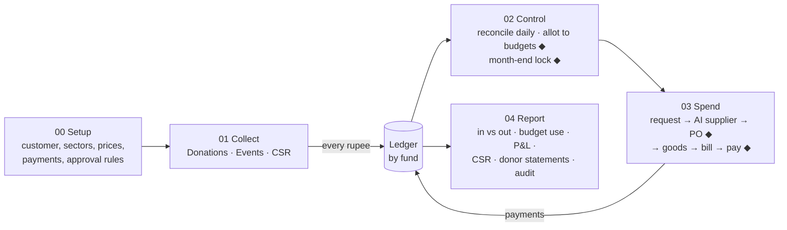

# OMG Platform — Core Modules: Flow + Build Plan (for Claude Code)

> Scope: everything on page 1 of the process sheet **except Events (already built)** and **CSR (separate plan: `docs/csr/PLAN.md`)**.
> Modules covered: **00 Setup**, **01 Collect (Donations)**, **02 Control (Funds, Budgets, Reconciliation, Month-end)**, **03 Spend (Procurement)**, **04 Report**.
> Put this file at `docs/core/PLAN.md`.

---

## 1. How the modules connect



**The one idea everything depends on:** a single **ledger**. Every money movement (donation, fee, allotment, payment, refund) is one ledger entry tagged with entity, sector, fund and (where relevant) budget. Reports read only from the ledger. Nothing edits a ledger entry — mistakes are fixed with a reversing entry.

### Build order (dependencies)
1. **Setup** (tenants, entities, roles, approval matrix) — everything needs it
2. **Ledger + Funds** (core of Control)
3. **Donations** (first real money in)
4. **Reconciliation + Month-end lock**
5. **Budgets + Spend**
6. **Reports**
7. Retrofit **Events** to post into the ledger (if it doesn't already)
8. **CSR** (its own plan, built on top)

---

## 2. Gaps and corrections found in the sheet

Decide these before coding. Defaults are given so work isn't blocked.

| # | Gap | Default |
|---|---|---|
| 1 | **Customer vs legal entity.** One customer (e.g. a temple) may run several legal bodies — temple trust, separate charitable trust for CSR. Receipts, bank accounts and tax registrations belong to the **legal entity**, not the customer. | Model: Customer → Legal Entity → Sector → Fund. |
| 2 | **Tax-benefit wording on temple receipts.** From the CSR research: a wholly religious trust generally has no Sec 354 (old 80G) approval. | Receipt says "eligible for tax deduction" **only** if the entity has a valid Sec 354 approval on file. |
| 3 | **Physical Hundi.** The sheet only shows online Hundi. Temples also count physical Hundi boxes. | Include **offline collection entry** with two-person counting (maker-checker). |
| 4 | **Gateway fees.** ₹1,001 donated online arrives in the bank as less (gateway fee + GST). | Book the donation at full ₹1,001 (receipt amount); book the fee as an expense in reconciliation. |
| 5 | **"Budget left" in the example.** ₹50,000 − ₹9,600 = ₹40,400 is right, but the money should reduce when the **PO is approved** (committed), not only when paid. | Track three numbers per budget: **Allotted, Committed, Spent**. Available = Allotted − Committed − Spent. |
| 6 | **Pooja booking — donation or service fee?** May affect GST and receipt type. | Treat as **seva/offering** with its own receipt type; **CA to confirm GST**. |
| 7 | **Supplier bank-account change** is a common fraud route. | Bank detail changes need CA approval before any payment. |
| 8 | **TDS** on payments to contractors / service suppliers. | Store TDS section + rate per supplier; deduct at payment. **CA to confirm sections under the Income-tax Act 2025.** |
| 9 | **Refunds and failed payments** (pooja cancelled, duplicate payment). | Refund = reversing ledger entry, needs CA approval; receipt marked cancelled, never deleted. |
| 10 | **Unlocking a closed month.** | Only with CA + Trustee approval; logged with reason. |
| 11 | **Bank statement source.** | v1: CSV/Excel upload of bank statement. Bank API later. |

---

## 3. Module 00 — Setup (once per customer)

### Flow
```
Super Admin
 1. Create customer: name, logo, colours, subdomain
 2. Add legal entities: legal name, type (trust/society/Sec 8), PAN,
    registration nos, Sec 332 / Sec 354 status + expiry, FCRA (if any)
 3. Switch on sectors: Temple / Sevalaya / Tamil Sangam (each linked to one entity)
 4. Load prices: pooja list + prices, ticket defaults, item catalogue (units)
 5. Connect payments: entity's OWN merchant account on the gateway
    → save keys (encrypted) → register webhook → test ₹1 payment
 6. Set approval rules (who approves what, amount bands)
 7. Invite users and assign roles per sector
 8. Set financial year (Apr–Mar), receipt number format, opening balances
 → Customer goes LIVE only when the checklist is complete
```

### Rules
- Payment money must settle to the **entity's own bank account**. GWC never holds funds (avoids the RBI payment-aggregator rule — see CSR guide article `platform-model`).
- Gateway keys stored encrypted; never sent to the Flutter app.
- **Approval matrix** example:

| Action | Prepared by | Approved by | Band |
|---|---|---|---|
| Fund → budget allotment | Finance | CA | any |
| Purchase order | Procurement | CA | up to ₹1 lakh |
| Purchase order | Procurement | CA + Trustee | above ₹1 lakh |
| Payment release | Finance | CA | any |
| Refund | Counter / Admin | CA | any |
| Month unlock | CA | Trustee | any |
| Supplier bank change | Procurement | CA | any |

Bands are data, editable per customer. Rule everywhere: **approver ≠ preparer**.

### Roles
Super Admin (GWC) · Customer Admin · Sector Admin · Counter Staff · Store/Procurement · Finance · CA · Trustee · Devotee/Donor · Supplier (optional portal, later).

---

## 4. Module 01 — Collect (Donations)

Events and CSR collections already have their own flows; this covers **Hundi, Pooja/Seva, Project donations, offline counter, physical Hundi**.

### 4.1 Online donation flow
```
Devotee opens app/web
 → picks: Hundi (General) | Pooja/Seva (date, slot, name, gotram/star) | Project
 → enters amount (fixed price for pooja)
 → donor details: name, mobile, citizenship*, PAN (optional, needed for tax certificate)
 → server creates order (status PENDING) → payment gateway
 → gateway webhook (signature verified) → status PAID
 → ledger entry: Dr Gateway Receivable / Cr Donation income (fund, sector)
 → receipt number issued (sequential per entity per FY) → receipt PDF on SMS/WhatsApp/email
```
\* Citizenship: OCI / foreign blocked unless the entity has FCRA (CSR guide `donor-citizenship`).

### 4.2 Offline counter and physical Hundi
```
Counter donation:   staff enters amount + mode (cash/UPI QR/card) → receipt
                    cash ≥ ₹2 lakh from one person/day → BLOCKED; > ₹2,000 → warning (no tax benefit)

Hundi box opening:  Counter team A counts → enters denominations
                    Team B recounts → must match → CA approves
                    → ledger: Dr Cash / Cr Hundi income (General fund)
                    → cash deposited to bank → deposit slip uploaded → reconciled later
```

### Rules
- Payment status comes **only** from a verified webhook or server-side verify call — never from the app screen.
- Webhook handling is **idempotent** (same event twice = one entry).
- Receipt numbers: no gaps, never reused; cancelled receipts stay visible as CANCELLED.
- Project donations go to that **Project fund** (restricted).
- Anonymous donations counted per entity against the limit (CSR guide `anonymous-donations`) — alert only for charitable (non-religious) entities.
- Tax certificate data (PAN, amount) collected for the yearly statement; exported in May.

### Pooja booking extras
Slot capacity per day, blackout dates (festival days), booking confirmation with date/slot, priest's daily list (printable), cancellation → refund approval.

---

## 5. Module 02 — Control (Funds, Budgets, Reconciliation, Month-end)

### 5.1 Funds
| Fund type | Money from | Can be used for | Restricted? |
|---|---|---|---|
| General | Hundi, general donations | Anything approved | No |
| Project | Project donations | That project only | **Yes** |
| Event | Tickets, sponsors, event donations | That event only | **Yes** |
| CSR | CSR tranches | That CSR project only | **Yes** |

- Restricted funds cannot transfer to another fund (blocked in DB).
- Moving money from General to a Project/Event (e.g. topping up) is allowed with CA approval.

### 5.2 Daily reconciliation flow
```
Next morning (scheduled job + Finance screen)
 1. Pull gateway settlement report (API) — which payments were paid out, fees, refunds
 2. Match each PAID donation → settlement line (by gateway payment id)
 3. Upload bank statement CSV → match settlement payout → bank credit (amount + date ± 2 days)
 4. Post fees: Dr Gateway fees expense / Cr Gateway Receivable
 5. Show exceptions: paid-but-not-settled, settled-but-no-donation, amount mismatch,
    bank credit with no match
 6. Finance resolves exceptions; AI may SUGGEST matches for unmatched lines
    (similar amount/date/reference) — human confirms
 7. Day marked RECONCILED
```
Example from the sheet: ₹1,001 Hundi → matched to next morning's gateway payout → bank credit matched.

### 5.3 Allotting money to budgets
```
Finance prepares: from fund X → budget "Pooja materials" ₹50,000 for period
 → ◆ CA approves (≠ preparer)
 → ledger: fund balance earmarked; budget Allotted = ₹50,000
```
Budget numbers kept live: **Allotted · Committed (approved POs not yet paid) · Spent · Available**.

### 5.4 Month-end lock
```
Pre-checks (all must pass):
  ✓ every day of the month RECONCILED
  ✓ no PAID donation without receipt
  ✓ no PO in "goods received, bill pending" older than 30 days (warning only)
  ✓ Hundi counts approved and deposited
 → Finance requests lock → ◆ CA locks
 → no entries dated in that month can be added or changed
 → corrections go in the next open month as adjustments
 → unlock only with CA + Trustee approval and a reason
```

---

## 6. Module 03 — Spend (Procurement)

### Flow (with the ghee example)
```
1. REQUEST     Store staff: "15 kg ghee for Pooja materials"     (item, qty, needed-by, budget)
2. SUGGEST     AI ranks suppliers from past orders:
                 Sri Lakshmi Traders — ₹640/kg avg last 6 orders, 100% on-time, bills matched
               → suggested ₹9,600 (15 × ₹640)
3. PO          Procurement creates PO (can pick another supplier — must give reason)
4. ◆ APPROVE   CA approves IF Available ≥ PO amount (₹50,000 ≥ ₹9,600)
               → Committed +₹9,600 → Available ₹40,400
               (above band → CA + Trustee)
5. RECEIVE     Store records goods received (qty, quality OK, photo) = GRN
6. BILL        Supplier bill entered/uploaded; 3-way match: PO ↔ GRN ↔ Bill
               (qty equal, rate equal, total within ₹ tolerance)
               mismatch → exception to Procurement + CA
7. ◆ PAY       Finance prepares payment (TDS if applicable) → CA releases
               → bank transfer → Committed −₹9,600, Spent +₹9,600
               → ledger: Dr Expense (budget) / Cr Bank
8. REPORT      Budget shows ₹40,400 left
```

### How the AI supplier suggestion works (numbers by formula, words by AI)
For the requested item, from the last 12 months of **paid** POs:
- **Fair price** = median unit rate of last 6 orders (any supplier), adjusted for none in v1.
- **Supplier score** = 50% price (vs fair price) + 30% on-time delivery + 20% bill-match rate.
- Show top 3 with their numbers. Claude writes one line explaining the top pick.
- PO rate more than 15% above fair price → warning shown to CA at approval.
- No history → no suggestion; procurement collects 3 quotes (upload).

### Supplier master
Name, PAN, GSTIN, address, bank account (verified), items supplied, TDS section/rate (CA to set), status (ACTIVE/BLOCKED). Bank change → CA approval + cooling period before next payment.

### Stock (simple v1)
Items with unit; stock in from GRN; stock out on issue to pooja/kitchen/event; current balance; low-stock alert. No valuation methods in v1.

### Links to other modules
- PO table has `event_id` / `event_budget_line_id` (Events) and `csr_project_id` / `csr_budget_line_id` (CSR). **Phase 0 must check what Events already created** and extend rather than duplicate.
- CSR POs also check blocked categories and admin-overhead cap (CSR plan B3).

---

## 7. Module 04 — Report

| Report | For | Contents | Source |
|---|---|---|---|
| **Money in vs out** | Trustees | By sector and fund, month / FY, opening + in − out = closing | Ledger |
| **Budget utilisation** | CA, Trustees | Allotted · Committed · Spent · Available per budget; % used; over-run flags | Budgets + POs |
| **Event P&L** | CA, Trustees | Already built — link into the hub | Events |
| **CSR reports** | Companies, CA | UC, fund statement, progress (CSR plan) | CSR |
| **Donor statement** | Donors | All donations by donor for FY, receipt nos, tax-eligible flag | Donations |
| **Reconciliation status** | Finance, CA | Days reconciled, open exceptions | Reconciliation |
| **Supplier spend** | CA | By supplier, item, rate trend vs fair price | POs |
| **Audit trail** | Auditor | Who prepared/approved what, when, before/after values | Audit log |
| **Trustee dashboard** | Trustees | Balances by fund, this month in/out, top budgets used, pending approvals, alerts | All |

Rules: reports read from the ledger and approved data only; every figure drills down to the entries behind it; export to PDF and Excel; locked months marked "Final".

---

## 8. Data model (PostgreSQL — adapt to existing schema)

```sql
-- SETUP
create table customers (id uuid primary key, name text not null, logo_path text,
  primary_colour text, secondary_colour text, subdomain text unique, status text not null default 'SETUP');

create table legal_entities (id uuid primary key, customer_id uuid not null references customers(id),
  legal_name text not null, entity_type text not null, pan text not null,
  sec354_valid_until date, fcra_reg_no text, fcra_valid_until date,
  is_wholly_religious boolean not null default false,
  receipt_prefix text not null, fy_start_month int not null default 4);

create table sectors (id uuid primary key, entity_id uuid not null references legal_entities(id),
  kind text not null check (kind in ('TEMPLE','SEVALAYA','TAMIL_SANGAM')), enabled boolean not null default true);

create table payment_connections (id uuid primary key, entity_id uuid not null references legal_entities(id),
  provider text not null, merchant_id text not null, key_ref text not null,   -- secret manager reference
  webhook_secret_ref text not null, status text not null default 'TEST');

create table approval_rules (id uuid primary key, customer_id uuid not null, action text not null,
  min_amount numeric(14,2) default 0, max_amount numeric(14,2),
  approver_roles text[] not null);        -- all listed roles must approve, in order

-- LEDGER (single source of truth)
create table funds (id uuid primary key, entity_id uuid not null references legal_entities(id),
  sector_id uuid references sectors(id), fund_type text not null
  check (fund_type in ('GENERAL','PROJECT','EVENT','CSR')),
  name text not null, restricted boolean not null, ref_id uuid);   -- project/event/csr deal id

create table accounts (code text primary key, name text not null,
  kind text not null check (kind in ('ASSET','LIABILITY','INCOME','EXPENSE','EQUITY')));
-- seed: BANK, CASH, GATEWAY_RECEIVABLE, DONATION_INCOME, HUNDI_INCOME, SEVA_INCOME,
--       GATEWAY_FEES, PURCHASE_EXPENSE, SUPPLIER_PAYABLE, TDS_PAYABLE, REFUNDS ...

create table journal_entries (id uuid primary key, entity_id uuid not null, entry_date date not null,
  source_type text not null, source_id uuid not null, narration text,
  reverses_id uuid references journal_entries(id),
  created_by uuid not null, created_at timestamptz not null default now());

create table journal_lines (id uuid primary key, entry_id uuid not null references journal_entries(id),
  account_code text not null references accounts(code), fund_id uuid not null references funds(id),
  budget_id uuid, debit numeric(14,2) not null default 0, credit numeric(14,2) not null default 0,
  check (debit >= 0 and credit >= 0 and (debit = 0) <> (credit = 0)));
-- Rule (trigger or service): sum(debit) = sum(credit) per entry; no UPDATE/DELETE on these tables;
-- entry_date must be in an OPEN period.

create table periods (entity_id uuid not null, year_month char(7) not null,
  status text not null default 'OPEN', locked_by uuid, locked_at timestamptz,
  primary key (entity_id, year_month));

-- COLLECT
create table donors (id uuid primary key, name text, mobile text, email text,
  citizenship text check (citizenship in ('INDIAN','NRI_INDIAN','OCI','FOREIGN')),
  pan text, address text, consent_at timestamptz);

create table donations (id uuid primary key, entity_id uuid not null, sector_id uuid not null,
  fund_id uuid not null references funds(id), donor_id uuid references donors(id),
  kind text not null check (kind in ('HUNDI','SEVA','PROJECT','GENERAL')),
  seva_id uuid, seva_date date, seva_slot text,
  amount numeric(14,2) not null check (amount > 0),
  mode text not null,                         -- ONLINE, CASH, UPI_QR, CARD, CHEQUE
  gateway_order_id text unique, gateway_payment_id text unique,
  status text not null default 'PENDING',     -- PENDING, PAID, FAILED, REFUNDED
  receipt_no text unique, receipt_status text, -- ISSUED, CANCELLED
  is_anonymous boolean not null default false,
  created_by uuid, created_at timestamptz not null default now());

create table hundi_counts (id uuid primary key, sector_id uuid not null, box_label text not null,
  opened_on date not null, count_a jsonb not null, count_b jsonb,  -- {denomination: qty}
  total_a numeric(14,2) not null, total_b numeric(14,2),
  counted_by_a uuid not null, counted_by_b uuid, approved_by uuid,
  deposit_slip_path text, status text not null default 'COUNTING',
  check (counted_by_b is null or counted_by_b <> counted_by_a));

create table sevas (id uuid primary key, sector_id uuid not null, name text not null,
  price numeric(12,2) not null, daily_capacity int, active boolean not null default true);

-- CONTROL
create table budgets (id uuid primary key, fund_id uuid not null references funds(id),
  name text not null, period_from date not null, period_to date not null,
  allotted numeric(14,2) not null default 0, status text not null default 'DRAFT');
-- committed/spent computed from POs and journal lines (view), never typed

create table gateway_settlements (id uuid primary key, entity_id uuid not null, settlement_id text unique,
  payout_date date, gross numeric(14,2), fees numeric(14,2), tax_on_fees numeric(14,2),
  net numeric(14,2), raw jsonb);
create table settlement_lines (settlement_id uuid references gateway_settlements(id),
  gateway_payment_id text, amount numeric(14,2), fee numeric(14,2), kind text);  -- PAYMENT, REFUND
create table bank_statement_lines (id uuid primary key, entity_id uuid not null, txn_date date,
  description text, reference text, debit numeric(14,2), credit numeric(14,2), balance numeric(14,2),
  matched_type text, matched_id uuid, upload_batch uuid);
create table recon_days (entity_id uuid, day date, status text default 'OPEN',
  exceptions int default 0, reconciled_by uuid, primary key (entity_id, day));

-- SPEND
create table suppliers (id uuid primary key, customer_id uuid not null, name text not null,
  pan text, gstin text, bank_account_ref text, bank_verified boolean default false,
  bank_changed_at timestamptz, tds_section text, tds_rate numeric(5,2), status text default 'ACTIVE');
create table items (id uuid primary key, customer_id uuid not null, name text not null, unit text not null,
  category text not null);
create table purchase_requests (id uuid primary key, sector_id uuid not null, budget_id uuid not null,
  item_id uuid not null, qty numeric(12,3) not null, needed_by date, requested_by uuid not null,
  status text default 'OPEN');
create table purchase_orders (id uuid primary key, request_id uuid references purchase_requests(id),
  supplier_id uuid not null references suppliers(id), budget_id uuid not null references budgets(id),
  event_id uuid, event_budget_line_id uuid, csr_project_id uuid, csr_budget_line_id uuid,
  qty numeric(12,3) not null, rate numeric(12,2) not null, amount numeric(14,2) not null,
  fair_rate numeric(12,2), ai_note text, override_reason text,
  status text not null default 'DRAFT',  -- DRAFT, PENDING_APPROVAL, APPROVED, RECEIVED, BILLED, PAID, CANCELLED
  prepared_by uuid not null);
create table goods_receipts (id uuid primary key, po_id uuid not null references purchase_orders(id),
  qty_received numeric(12,3) not null, quality_ok boolean not null, photo_path text,
  received_by uuid not null, received_at timestamptz default now());
create table supplier_bills (id uuid primary key, po_id uuid not null references purchase_orders(id),
  bill_no text not null, bill_date date not null, amount numeric(14,2) not null, file_path text,
  match_status text, unique (po_id, bill_no));
create table payments (id uuid primary key, bill_id uuid not null references supplier_bills(id),
  gross numeric(14,2) not null, tds numeric(14,2) not null default 0, net numeric(14,2) not null,
  bank_ref text, prepared_by uuid not null, released_by uuid, released_at timestamptz,
  check (released_by is null or released_by <> prepared_by));
create table stock_moves (id uuid primary key, item_id uuid not null, sector_id uuid not null,
  qty numeric(12,3) not null, direction text check (direction in ('IN','OUT')),
  source_type text, source_id uuid, moved_at timestamptz default now());

-- SHARED (reuse if Events created them)
-- approvals(...)  audit_log(id, actor, action, entity_type, entity_id, before jsonb, after jsonb, at)
```

### Ledger postings (reference)

| Event | Debit | Credit | Fund |
|---|---|---|---|
| Online donation PAID ₹1,001 | Gateway Receivable 1,001 | Hundi Income 1,001 | General |
| Settlement (fee ₹24 incl. GST) | Bank 977 + Gateway Fees 24 | Gateway Receivable 1,001 | General |
| Hundi box ₹48,500 approved | Cash 48,500 | Hundi Income 48,500 | General |
| Cash deposited | Bank 48,500 | Cash 48,500 | General |
| Bill entered ₹9,600 | Purchase Expense 9,600 (budget: Pooja materials) | Supplier Payable 9,600 | General |
| Payment released | Supplier Payable 9,600 | Bank 9,600 (− TDS if any → TDS Payable) | General |
| Refund ₹1,001 | Refunds 1,001 | Bank 1,001 | same as original |

Budget **allotment** is an earmark (budget record), not a journal entry — the money stays in the fund until spent. (The fee figure is illustrative only.)

---

## 9. Key APIs (adapt to existing style)

| Area | Endpoints |
|---|---|
| Setup | `POST /customers`, `POST /entities`, `POST /sectors`, `PUT /sevas`, `POST /payment-connections` + `/test`, `PUT /approval-rules`, `POST /users/invite`, `GET /customers/{id}/go-live-checklist` |
| Collect | `POST /donations/order`, `POST /webhooks/{provider}`, `GET /donations/{id}/receipt`, `POST /donations/offline`, `POST /hundi-counts`, `/{id}/recount`, `/{id}/approve`, `POST /donations/{id}/refund` |
| Control | `GET /funds`, `POST /budgets`, `/{id}/submit`, `POST /recon/settlements/pull`, `POST /recon/bank-statement` (upload), `GET /recon/exceptions`, `POST /recon/match`, `POST /recon/days/{day}/close`, `POST /periods/{ym}/lock`, `/unlock` |
| Spend | `POST /purchase-requests`, `GET /purchase-requests/{id}/suggestions`, `POST /purchase-orders`, `/{id}/submit`, `POST /goods-receipts`, `POST /supplier-bills`, `POST /payments`, `/{id}/release`, `PUT /suppliers/{id}/bank` |
| Report | `GET /reports/in-out`, `/budget-utilisation`, `/donor-statement/{donorId}`, `/recon-status`, `/supplier-spend`, `/audit`, `/dashboard` (all with `?format=pdf|xlsx`) |
| Approvals | `GET /approvals/inbox`, `POST /approvals/{id}/decide` (shared with Events/CSR) |

---

## 10. Build phases for Claude Code

Plan mode first for each phase, review, then code. Commit per phase.

### Phase 0 — Discover (no code)
> Read `docs/core/PLAN.md`, `docs/events/PLAN.md`, `docs/csr/PLAN.md`. Inspect the repo and the **implemented Events module**: which tables exist for customers, approvals, funds, purchase orders, audit log, payments. Report how Events records money today and what must change to post into a ledger. List conflicts. Update `CLAUDE.md` with decisions.

### Phase 1 — Setup
> Customers, legal entities, sectors, roles, approval matrix (data-driven bands), seva/price lists, payment connection with encrypted keys and test payment, go-live checklist.

Done when: a customer cannot go LIVE with any checklist item missing; approval rules resolve correctly for amounts on each band edge.

### Phase 2 — Ledger + Funds + Periods
> Accounts, funds, journal entries/lines with balanced-entry check, no update/delete, open-period check, reversal helper, fund balance views, restricted-fund transfer block.

Done when: tests prove unbalanced entries and edits are rejected; posting into a locked month fails.

### Phase 3 — Donations
> Online flow with gateway order + verified, idempotent webhook; receipts (sequential per entity/FY, PDF, SMS/WhatsApp/email hooks); tax-eligible wording only with valid Sec 354; citizenship block; cash rules; offline counter; Hundi two-person count; seva slots; refunds via approval.

Done when: replaying the same webhook 5 times creates one donation and one ledger entry; Hundi count with A≠B cannot be approved.

### Phase 4 — Reconciliation + Month-end
> Settlement pull, bank CSV upload with column mapping, auto-match rules, exceptions screen, AI match suggestions (human confirms), fee posting, day close, month lock pre-checks and lock/unlock approvals.

Done when: the ₹1,001 example reconciles end to end in a test; month lock is refused while any day is unreconciled.

### Phase 5 — Budgets + Spend
> Budgets with allot approval, Allotted/Committed/Spent/Available view, suppliers (bank change approval), items, requests, AI supplier suggestion (formula + Claude one-liner), POs with budget check and bands, GRN, bills with 3-way match, payments with TDS and release approval, simple stock. Link Event and CSR fields on POs.

Done when: the ghee example gives Available ₹40,400 after PO approval and stays ₹40,400 after payment; a PO above Available is blocked.

### Phase 6 — Retrofit Events
> Make the existing Events module post tickets, sponsors, event donations and event POs into the ledger under its Event fund, without breaking its current screens. Event P&L should match the ledger.

### Phase 7 — Reports + Dashboard
> All reports in section 7 from ledger views (consider materialised views refreshed on posting), drill-down, PDF/Excel export, "Final" mark on locked months, trustee dashboard.

Done when: money in − money out per fund equals the ledger fund balance for every test month.

### Phase 8 — Hardening
> Audit log on every state change, approval inbox with notifications, rate limits, backups, end-to-end test: setup → donation → reconcile → allot → PO → pay → month lock → reports.

---

## 11. Open questions for the team / CA
1. Pooja/seva payments: donation or service fee — GST treatment?
2. Is physical Hundi counting in scope for v1?
3. Which payment gateway, and does it give a settlement API?
4. Bank statement: which banks, and their CSV formats?
5. TDS sections and rates for our common suppliers under the new Act.
6. PO approval bands (₹1 lakh default) per customer.
7. Receipt number format and whether one series per entity or per sector.
8. Refund policy for cancelled poojas.
9. Opening balances: who provides them, as of which date?
